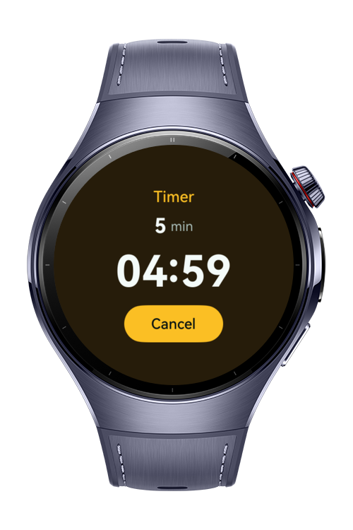
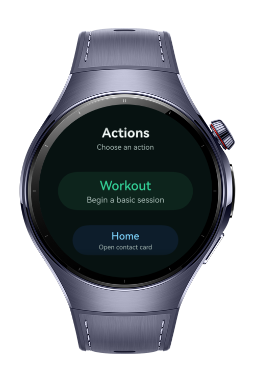
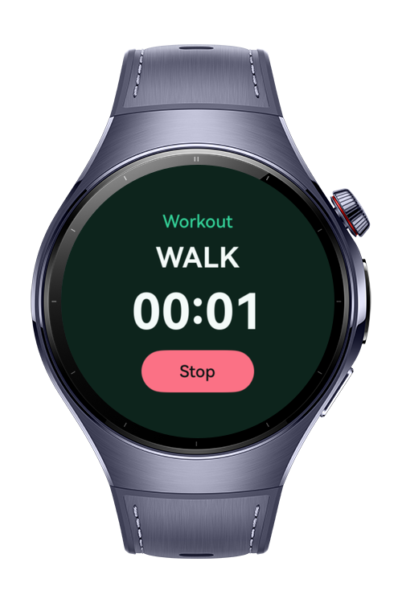

> **Note:** To access all shared projects, get information about environment setup, and view other guides, please visit [Explore-In-HMOS Index](https://github.com/Explore-In-HMOS/hmos-index).

# How To Build Intent Driven Actions

Intent Driven Actions is a HarmonyOS wearable sample built with ArkTS and ArkUI. The app demonstrates how a watch app can expose simple actions to the system through InsightIntent entries, open the matching foreground UI, and return a structured execution result.

# Preview

<div>
    
	
    
</div>

# Use Cases

- Start a lightweight workout session from a system intent or the in-app action hub
- Open a saved home contact confirmation page without placing a real call
- Start a short countdown timer from an intent duration parameter
- Bind intent metadata to ArkTS executor classes with `@InsightIntentEntry`
- Launch `EntryAbility` in `UI_ABILITY_FOREGROUND` mode for immediate watch feedback
- Return consistent success or failure results from each intent executor

- **Action Hub**: circular `ArcList` layout with Workout, Home, and Timer actions for manual testing.
- **Workout Started**: compact workout status page with workout type, elapsed time, and Stop action.
- **Home Contact Ready**: confirmation page for the saved contact label with a Dismiss action.
- **Timer Started**: countdown page using the intent duration in minutes with a Cancel action.
- **Intent Logging**: intent entry, router, ability, and page lifecycle logs use the `IntentActions` tag.

Work Conditions
- The app is designed for HarmonyOS wearable devices with round screens.
- The sample focuses on the InsightIntent execution flow. Workout tracking, telephony, and long-running alarm behavior are mock app actions.
- `StartWorkout`, `CallHome`, and `SetTimer` are declared with `@InsightIntentEntry` decorators.
- All intent entries use `insightIntent.ExecuteMode.UI_ABILITY_FOREGROUND` so the watch displays the related page.
- `StartWorkout` accepts an optional `workoutType` parameter and defaults to `walk`.
- `CallHome` accepts an optional `contactLabel` parameter and defaults to `home`.
- `SetTimer` accepts a required `durationMinutes` parameter and falls back to `5` if the runtime value is invalid.
- The router launches `EntryAbility` with an `intentaction://` URI, and `EntryAbility` maps the action to the correct page.
- Logs can be filtered with `IntentActions` to inspect input parameters, launch URIs, page routing, and result codes.

# Technology

## Stack

- **Languages**: ArkTS, ArkUI
- **Frameworks**: HarmonyOS Stage Model, InsightIntent
- **Tools**: DevEco Studio, Hvigor, ohpm
- **Libraries**:
	- `@kit.AbilityKit`
	- `@kit.ArkUI`
	- `@kit.PerformanceAnalysisKit`
	- `@ohos.arkui.ArcList`

## Required Permissions

- No special app permissions are required.
- The call home sample opens a confirmation page only. It does not place a phone call or request telephony permissions.

# Directory Structure

```
entry/
|   src/
|       main/
|       |   module.json5
|       |
|       |---ets
|       |   |---entryability
|       |   |       EntryAbility.ets
|       |   |
|       |   |---entrybackupability
|       |   |       EntryBackupAbility.ets
|       |   |
|       |   |---insightintents
|       |   |       CallHomeIntentEntry.ets
|       |   |       IntentActionRouter.ets
|       |   |       IntentActionTypes.ets
|       |   |       IntentResultFactory.ets
|       |   |       SetTimerIntentEntry.ets
|       |   |       StartWorkoutIntentEntry.ets
|       |   |
|       |   |---pages
|       |   |       CallHomePage.ets
|       |   |       Index.ets
|       |   |       TimerPage.ets
|       |   |       WorkoutPage.ets
|       |
|       |---resources
|               base/
|               dark/
|
|       test/
|           LocalUnit.test.ets
```

# Constraints and Restrictions

## Supported Device

- Huawei Watch 5
- HarmonyOS smart wearables
- Round-screen wearable layouts are the primary target
- InsightIntent decorator support is intended for API version 20 and later.
- Real system voice command, shortcut, or smart suggestion invocation depends on device and system InsightIntent integration.
- Manual action buttons are included so the pages can be tested even before a real system intent trigger is connected.

# License

**How To Build Intent Driven Actions** is distributed under the terms of the MIT License. See the [LICENSE](LICENSE) for more information
